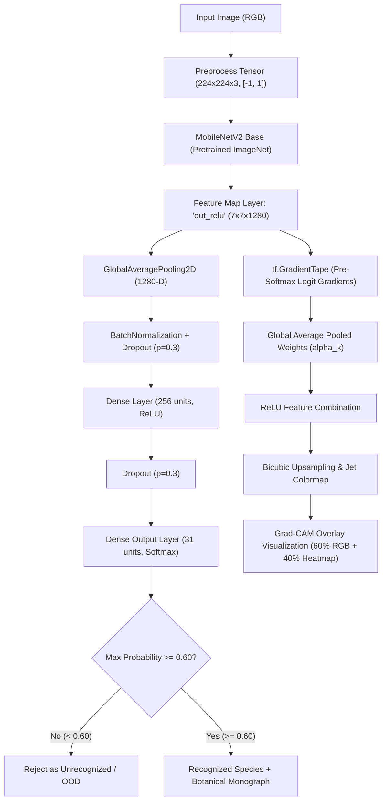

# 🌸 Medicinal Flower Recognition & Explainable AI (Grad-CAM)

[](https://www.python.org/)
[](https://tensorflow.org/)
[](https://flask.palletsprojects.com/)
[](models/medicinal_flower_model.keras)
[](training/results/test_evaluation.json)
[](training/gradcam.py)
[](LICENSE)

An end-to-end Deep Learning and Explainable AI (XAI) system engineered to classify **31 Indian Medicinal Flower species** with **98.97% test accuracy** using Transfer Learning (MobileNetV2), featuring real-time visual feature attribution (Grad-CAM heatmaps), out-of-distribution confidence thresholding, and a full-featured Flask web dashboard.

---

## 📌 Table of Contents
- [Executive Overview](#-executive-overview)
- [Key Features](#-key-features)
- [System Architecture & Pipeline](#-system-architecture--pipeline)
- [Explainable AI (Grad-CAM) Formulation](#-explainable-ai-grad-cam-formulation)
- [Out-of-Distribution (OOD) Confidence Thresholding](#-out-of-distribution-ood-confidence-thresholding)
- [Test Evaluation & Benchmarks](#-test-evaluation--benchmarks)
- [Supported 31 Medicinal Flower Species](#-supported-31-medicinal-flower-species)
- [Repository Structure](#-repository-structure)
- [Installation & Quickstart](#-installation--quickstart)
- [Running the Web Application](#-running-the-web-application)
- [Command-Line Inference (predict.py)](#-command-line-inference-predictpy)
- [Test Suite & Verification](#-test-suite--verification)
- [Dataset Details & Source Attribution](#-dataset-details--source-attribution)
- [Viva & Presentation Q&A Guide](#-viva--presentation-qa-guide)

---

## 🎯 Executive Overview

Medicinal flora represents a primary pillar of traditional medicine systems including Ayurveda, Siddha, and Unani. However, accurate morphological species identification presents significant hurdles:
1. **Intra-class botanical variation**: Petal geometry, color intensity, and maturity stages vary widely within the same species.
2. **Inter-class visual similarity**: Multiple distinct medicinal species exhibit overlapping color palettes and floral structures.
3. **Black-box AI opacity**: Standard deep neural networks produce probabilistic outputs without explaining *which* anatomical flower parts triggered the decision.

This repository resolves these challenges by integrating **MobileNetV2 transfer learning**, **mathematically un-saturated Grad-CAM explainability**, and an **OOD confidence gate ($\tau = 0.60$)** to deliver safe, transparent, and interpretable botanical classification.

---

## ✨ Key Features

- 🌺 **31 Medicinal Species**: Classifies essential medicinal plants (*Adathoda*, *Datura*, *Hibiscus*, *Nityakalyani*, *Tridax procumbens*, *Thumba*, and 25 others).
- 🧠 **Transfer Learning (MobileNetV2)**: Pretrained ImageNet weights with depthwise separable convolutions for high inference speed and low parameter overhead.
- 🔬 **Grad-CAM Visual Heatmaps**: Generates color-coded spatial attribution maps highlighting the floral organs (stamens, petals, stigma) driving classification.
- 🛡️ **Confidence Thresholding (OOD Rejection)**: Automatically rejects non-flower imagery, blurred photos, or unsupported flora when max class probability drops below `0.60`.
- 🌐 **Modern Glassmorphic Web App**: Drag-and-drop file upload, dynamic progress bars for top-5 candidates, side-by-side Grad-CAM visualizations, and detailed medicinal monographs.
- 💻 **Robust CLI Tool (`predict.py`)**: Supports single image classification, `--gradcam` visual exports, and `--output_json` programmatic output.
- 🧪 **Comprehensive Automated Test Suite**: Built-in verification tests covering API routes, single-model caching, Grad-CAM numerical gradients, and environment compatibility.

---

## 🏗️ System Architecture & Pipeline



### Classification Head Specification
| Layer Name | Layer Type | Output Dimension | Activation / Details |
|---|---|---|---|
| `input_image` | InputLayer | $(224, 224, 3)$ | RGB Image Tensor |
| `mobilenetv2_1.00_224` | Functional | $(7, 7, 1280)$ | Feature Extractor (`out_relu`) |
| `global_avg_pool` | GlobalAveragePooling2D | $(1280)$ | Spatial Reduction |
| `batch_norm` | BatchNormalization | $(1280)$ | Stabilizes activations |
| `dropout_1` | Dropout | $(1280)$ | Rate: $0.3$ |
| `dense_256` | Dense | $(256)$ | ReLU Activation |
| `dropout_2` | Dropout | $(256)$ | Rate: $0.3$ |
| `predictions` | Dense | $(31)$ | Softmax Activation |

---

## 🔍 Explainable AI (Grad-CAM) Formulation

Standard Grad-CAM computes gradients of target score with respect to convolutional feature maps. If calculated on post-softmax probabilities $S_c$, high-confidence predictions ($S_c \approx 1.0$) cause gradient vanishing because:

$$\frac{\partial S_c}{\partial z_c} = S_c(1 - S_c) \approx 1.0 \times (1.0 - 1.0) = 0.0$$

To guarantee mathematically valid gradients without saturation, our implementation tracks the **un-normalized pre-softmax logit ($z_c$)**:

### 1. Neuron Importance Weights ($\alpha_k^c$)
$$\alpha_k^c = \frac{1}{Z} \sum_{i=1}^{U} \sum_{j=1}^{V} \frac{\partial z^c}{\partial A_{i,j}^k}$$
Where $A^k$ is feature map $k$ of layer `out_relu` ($7 \times 7 \times 1280$), and $Z = 7 \times 7 = 49$.

### 2. Weighted Rectified Combination ($L_{\text{Grad-CAM}}^c$)
$$L_{\text{Grad-CAM}}^c = \text{ReLU}\left( \sum_{k=1}^{1280} \alpha_k^c A^k \right)$$
The $\text{ReLU}$ function retains features that positively support class $c$, ignoring features contributing to other categories.

### 3. Normalization & Jet Colormap Overlay
The $7 \times 7$ map is normalized to $[0, 1]$, bicubically resized to $224 \times 224$, and blended:
$$\text{Overlay} = 0.6 \times I_{\text{RGB}} + 0.4 \times \text{Colormap}_{\text{JET}}(L^c)$$

---

## 🛡️ Out-of-Distribution (OOD) Confidence Thresholding

To prevent hallucinated false-positive classifications on non-flower images, pets, objects, or unsupported flora, maximum softmax probability thresholding is enforced:

$$\hat{y} = \begin{cases} \arg\max_{c} P(y=c \mid X) & \text{if } \max_{c} P(y=c \mid X) \ge \tau \\ \text{Unrecognized / Unsupported} & \text{if } \max_{c} P(y=c \mid X) < \tau \end{cases}$$

- **Selected Threshold ($\tau$)**: `0.60`
- **Validation Acceptance Rate**: `99.72%`
- **Accuracy on Accepted Samples**: `99.86%`
- **Config**: [`models/prediction_config.json`](models/prediction_config.json)

---

## 📊 Test Evaluation & Benchmarks

Independent test evaluation on **1,456 held-out test images** (zero data leakage) yielded:

| Evaluation Metric | Test Score |
|---|---|
| **Test Accuracy** | **98.97%** |
| **Test Categorical Loss** | **0.0248** |
| **Macro Precision** | **98.66%** |
| **Macro Recall** | **98.47%** |
| **Macro F1-Score** | **98.54%** |
| **Weighted Precision** | **99.00%** |
| **Weighted Recall** | **98.97%** |
| **Weighted F1-Score** | **98.97%** |

### Top Performing Classes (100% Precision & Recall)
- **Allium Cepa** ($F1 = 1.0000$, Support: $129$)
- **Black Cumin** ($F1 = 1.0000$, Support: $189$)
- **Champaka** ($F1 = 1.0000$, Support: $35$)
- **Common Lanthana** ($F1 = 1.0000$, Support: $35$)
- **Datura** ($F1 = 1.0000$, Support: $36$)

Detailed evaluation curves, report text, and confusion matrix are saved in [`training/results/`](training/results/).

---

## 🌿 Supported 31 Medicinal Flower Species

| # | Common Name | Scientific Botanical Name | Primary Medicinal Applications |
|---|---|---|---|
| 1 | Adathoda | *Justicia adhatoda* | Respiratory ailments, chronic bronchitis, asthma |
| 2 | Allium Cepa | *Allium cepa* | Anti-inflammatory, antimicrobial, cardiovascular health |
| 3 | Banana | *Musa paradisiaca* | Digestive disorders, diabetes regulation, ulcer healing |
| 4 | Black Cumin | *Nigella sativa* | Immunomodulation, antioxidant, anti-inflammatory |
| 5 | Bush Clock Vine | *Thunbergia erecta* | Anti-inflammatory, fever reduction, detoxifier |
| 6 | Champaka | *Magnolia champaca* | Antipyretic, cephalic headaches, ophthalmia |
| 7 | Chitrak | *Plumbago zeylanica* | Digestive stimulation, hepatoprotective, skin diseases |
| 8 | Common Lanthana | *Lantana camara* | Antiseptic, rheumatism, dermatological washes |
| 9 | Crown Flower | *Calotropis gigantea* | Joint inflammation, dermatological ailments, asthma |
| 10 | Datura | *Datura metel* | Analgesic, antispasmodic, asthma (toxic in raw form) |
| 11 | Four O' Clock Flower | *Mirabilis jalapa* | Wound healing, antimicrobial, abdominal pain |
| 12 | Hibiscus | *Hibiscus rosa-sinensis* | Hair health, hypertension, cardioprotection, cooling |
| 13 | Honey Suckle | *Lonicera japonica* | Antiviral, upper respiratory tract infections, fever |
| 14 | Indian Mallow | *Abutilon indicum* | Demulcent, diuretic, rheumatism, urinary disorders |
| 15 | Jatropha | *Jatropha integerrima* | Purgative, eczema, skin scabies |
| 16 | Malabar Melastome | *Melastoma malabathricum* | Hemorrhoids, toothache, leucorrhea, wound healing |
| 17 | Marigold | *Tagetes erecta* | Wound healing, antiseptic, eye inflammation (lutein) |
| 18 | Nagapoovu | *Couroupita guianensis* | Antimicrobial, analgesic, colds and stomach ache |
| 19 | Nityakalyani | *Catharanthus roseus* | Vinca alkaloids for oncology, diabetes management |
| 20 | Pinwheel | *Tabernaemontana divaricata* | Ophthalmic cooling, analgesia, antimicrobial |
| 21 | Rose | *Rosa spp.* | Astringent, skin rejuvenation, anxiety, anti-inflammatory |
| 22 | Shankupushpam | *Clitoria ternatea* | Nootropic cognitive enhancer, memory, anxiety relief |
| 23 | Spider Lily | *Hymenocallis littoralis* | Antiviral alkaloid source (lycorine), joint swelling |
| 24 | Sunflower | *Helianthus annuus* | Rich in Vitamin E, antioxidant, cardiovascular support |
| 25 | Sweet Pea | *Lathyrus odoratus* | Traditional soothing wash, astringent properties |
| 26 | Thechi | *Ixora coccinea* | Dysentery, skin eruptions, hepatoprotective |
| 27 | Thumba | *Leucas aspera* | Sinusitis, snakebites, antipyretic, respiratory relief |
| 28 | Touch Me Not | *Mimosa pudica* | Hemostasis, wound cicatrization, gynecological health |
| 29 | Tridax procumbens | *Tridax procumbens* | Coagulant, rapid wound healing, antifungal |
| 30 | Wild Potato Vine | *Ipomoea pandurata* | Diuretic, purgative, kidney ailments |
| 31 | Yellow Daisy | *Wedelia chinensis* | Hepatoprotective, viral hepatitis, hair tonic |

---

## 📁 Repository Structure

```
Medicinal_flower/
│
├── app/                              # Flask Web Application
│   ├── app.py                        # Web application server & prediction API
│   ├── flower_information.json       # Botanical database for all 31 flower species
│   ├── static/                       # Client web assets
│   │   ├── css/style.css             # Glassmorphic botanical stylesheet
│   │   ├── js/main.js                # Frontend client logic & async fetch
│   │   ├── images/                   # Background & hero assets
│   │   ├── uploads/                  # Runtime upload directory (.gitkeep tracked)
│   │   └── gradcam/                  # Runtime Grad-CAM output directory (.gitkeep tracked)
│   └── templates/
│       └── index.html                # Responsive web dashboard
│
├── models/                           # Trained Models & Metadata
│   ├── medicinal_flower_model.keras  # MobileNetV2 trained checkpoint (~25.95 MB)
│   ├── class_names.json              # 31 target class names & index mapping
│   ├── prediction_config.json        # Confidence thresholding configuration (0.60)
│   └── training_history.json         # Accuracy/loss history across epochs
│
├── training/                         # Model Development & Evaluation
│   ├── build_model.py                # MobileNetV2 architecture builder
│   ├── train.py                      # Two-phase training script (frozen + fine-tuning)
│   ├── evaluate_model.py             # Test set evaluation & metrics generation
│   ├── gradcam.py                    # Standalone Grad-CAM computation module
│   ├── test_gradcam_batch.py         # Batch Grad-CAM validator across species
│   └── results/                      # Confusion matrix, classification report, curves
│
├── scripts/                          # Utilities & Integration Testing
│   ├── test_flask_app.py             # Server endpoint unit tests
│   ├── test_complete_integration.py  # 8-scenario integration test suite
│   ├── test_gradcam_fix.py           # Pre-softmax gradient validation
│   ├── validate_flower_information.py# Validates botanical database integrity
│   ├── verify_environment.py         # Environment & dependency verifier
│   ├── find_confidence_threshold.py  # Grid search for optimal OOD threshold
│   ├── inspect_model_layers.py       # Layer inspection & shape reporting
│   ├── merge_datasets.py             # IMFI + Kaggle dataset merger
│   ├── split_dataset.py              # 70/15/15 deterministic dataset splitter
│   └── download_dataset.py           # Dataset acquisition helper
│
├── predict.py                        # Command-line inference tool
├── requirements.txt                  # Python dependencies
├── .gitignore                        # Git ignore specifications
├── PROJECT_DETAILS.md                # Comprehensive technical specification
└── README.md                         # Main repository documentation
```

---

## ⚙️ Installation & Quickstart

### 1. Clone the Repository
```bash
git clone https://github.com/your-username/Medicinal_flower.git
cd Medicinal_flower
```

### 2. Create and Activate a Virtual Environment
> [!NOTE]
> TensorFlow requires **Python 3.10, 3.11, or 3.12**. If you have multiple Python versions installed on Windows (e.g. Python 3.14), use the `py -3.12` launcher to ensure the virtual environment is created with Python 3.12.

```bash
# Windows (Recommended if multiple Python versions exist)
py -3.12 -m venv .venv
.venv\Scripts\Activate.ps1

# macOS / Linux
python3 -m venv .venv
source .venv/bin/activate
```

### 3. Install Dependencies
```bash
pip install --upgrade pip
pip install -r requirements.txt
```

### 4. Verify Environment Setup
```bash
python scripts/verify_environment.py
```

---

## 🚀 Running the Web Application

Launch the Flask server:
```bash
python app/app.py
```
Open your browser and navigate to:
```
http://127.0.0.1:5000
```

### Web App Capabilities:
1. **Interactive Drag-and-Drop**: Upload JPG, JPEG, or PNG flower photos.
2. **Real-time Neural Inference**: View identified flower species and confidence score.
3. **Probability Rankings**: Live progress bars for top-5 class softmax probabilities.
4. **Visual Grad-CAM Explanation**: Side-by-side original image, heatmap, and overlay visualization showing focal areas.
5. **Botanical Monograph**: Instant access to botanical description, scientific name, and traditional Ayurvedic/herbal uses.
6. **OOD Safety Rejection**: Explains when an image does not meet confidence requirements.

---

## 💻 Command-Line Inference (`predict.py`)

Run fast predictions directly from your terminal:

### Basic Single Image Prediction:
```bash
python predict.py Hibiscus_flower_TZ.jpg
# Or explicitly using the flag:
python predict.py --image crownflower.jpeg
```

### Prediction with Grad-CAM Visualization:
```bash
python predict.py --image crownflower.jpeg --gradcam
# Saves a 3-panel explanation to: gradcam_crownflower.png
```

### Export Results to JSON:
```bash
python predict.py --image rose.jpg --output_json result.json
```

### Set Custom Confidence Threshold:
```bash
python predict.py --image sunflower.jpeg --threshold 0.75
```

---

## 🧪 Test Suite & Verification

The repository includes test suites to verify functionality:

### 1. Test Web Server Endpoints
```bash
python scripts/test_flask_app.py
```
Validates resource loading, HTTP 200 response on `GET /`, multipart upload on `POST /predict`, and error handling on invalid files.

### 2. Full 8-Scenario Application Integration Test
```bash
python scripts/test_complete_integration.py
```
Executes comprehensive end-to-end integration scenarios:
- Model caching verification (loaded once at startup)
- Known class recognition (Hibiscus, Rose, Sunflower, Datura)
- Distinct species recognition (Allium Cepa, Shankupushpam, Marigold)
- Background invariance across diverse lighting conditions
- Out-of-distribution synthetic noise and non-flower rejection
- Unsupported file format safety handling
- Empty payload boundary checks
- Consecutive prediction stability (zero memory leak verification)

### 3. Validate Botanical Database
```bash
python scripts/validate_flower_information.py
```
Confirms that all 31 classes have complete entries in `app/flower_information.json`.

---

## 📦 Dataset Details & Source Attribution

The model was trained on a combined dataset comprising **9,516 curated images** split into **70% training** (6,647 images), **15% validation** (1,413 images), and **15% test** (1,456 images).

### Sources:
1. **IMFI Dataset (Indian Medicinal Flower Image Dataset)**: 28 classes covering indigenous Indian medicinal species.
2. **Kaggle Medicinal Flower Dataset**: 3 complementary classes (*Allium Cepa*, *Black Cumin*, *Sweet Pea*). Available at: [Kaggle Dataset](https://www.kaggle.com/datasets/jannatulferdaues/medicinal-flower-dataset).

*Note: In accordance with repository best practices, large raw dataset directories (`dataset/`, `combined_dataset/`, `IMFI...`) are excluded from Git via `.gitignore`. The complete pre-trained model weights (`models/medicinal_flower_model.keras`) are included directly in the repository so the application works out of the box.*

---

## 🎓 Viva & Presentation Q&A Guide

Essential conceptual questions and answers for oral presentations and viva examinations:

<details>
<summary><b>1. Why did you choose MobileNetV2 over ResNet50 or VGG16?</b></summary>
<br>
MobileNetV2 utilizes <b>depthwise separable convolutions</b>, splitting standard convolution into a depthwise spatial filter and a 1x1 pointwise channel combiner. This reduces parameters (~3.5M vs ~25.6M for ResNet50) and floating-point operations by roughly 8x to 9x while retaining comparable accuracy, making it ideal for lightweight, real-time web inference.
</details>

<details>
<summary><b>2. Why do you use pre-softmax logits for Grad-CAM instead of softmax probabilities?</b></summary>
<br>
When a model classifies an image with high confidence (e.g., 99.9%), the post-softmax score $S_c$ approaches 1.0. Because the derivative of the Softmax function is $\frac{\partial S_c}{\partial z_c} = S_c(1 - S_c)$, the gradient approaches zero ($1.0 \times 0.0 = 0.0$). This causes <b>Softmax gradient saturation</b> and produces dark, zeroed heatmaps. Computing gradients using the unnormalized logit score $z_c$ before Softmax eliminates this problem and preserves strong visual attribution.
</details>

<details>
<summary><b>3. Why is the 'out_relu' layer chosen for Grad-CAM?</b></summary>
<br>
<code>out_relu</code> is the final 4D convolutional activation layer of MobileNetV2 with shape $(7 \times 7 \times 1280)$. It possesses the highest-level semantic representations (identifying petals, center floret discs, reproductive organs) while retaining 2D spatial coordinates before GlobalAveragePooling flattens the tensor into a 1D vector.
</details>

<details>
<summary><b>4. How does the system handle an image of a dog, car, or random object?</b></summary>
<br>
Standard softmax always normalizes outputs to sum to 1.0, which forces conventional classifiers to make false-positive predictions on irrelevant images. Our system implements <b>Out-of-Distribution (OOD) Confidence Gating ($\tau = 0.60$)</b>. If the top softmax probability is below 0.60, the prediction is rejected as "Not Recognized / Unsupported".
</details>

<details>
<summary><b>5. How did you prevent overfitting during training?</b></summary>
<br>
We applied four regularization strategies:
1. <b>Data Augmentation</b>: Random horizontal flips, rotations ($\pm 10\%$), zooms ($\pm 10\%$), and translations.
2. <b>Dropout</b>: Two dropout layers ($p = 0.3$) before and after the dense classification head.
3. <b>Batch Normalization</b>: Placed immediately after Global Average Pooling.
4. <b>Early Stopping & ReduceLROnPlateau</b>: Restores best checkpoint weights if validation loss stops improving.
</details>

---

## 📜 License & Acknowledgments

This project is licensed under the MIT License. Developed for educational research, botanical preservation, and explainable artificial intelligence.
